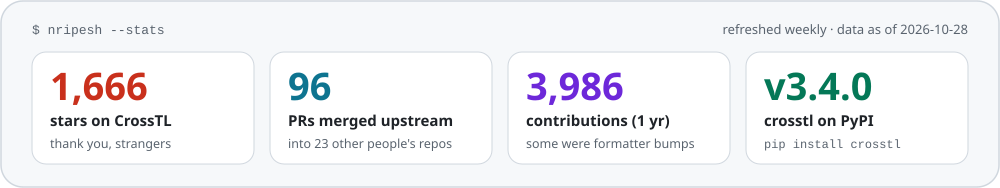
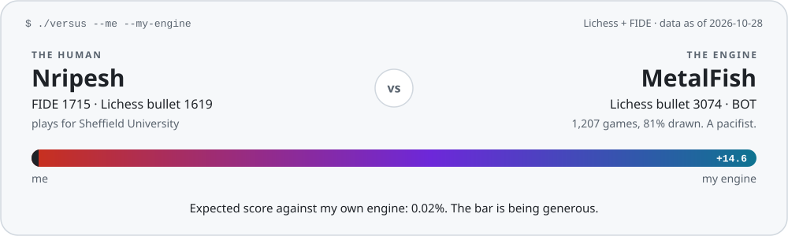

<!--
  Hello, source reader.
  The cards in assets/ are drawn by scripts/build_assets.py and redrawn every
  Monday by .github/workflows/refresh.yml, which also keeps their alt text
  below in step with the numbers.
-->

<a href="https://github.com/CrossGL/crosstl">
  <picture>
    <source media="(prefers-color-scheme: dark)" srcset="assets/hero-dark.svg">
    
  </picture>
</a>

<p align="center">
  <a href="https://crossgl.net"></a>
  <a href="https://scholar.google.com/citations?user=kDUtsL4AAAAJ"></a>
  <a href="https://orcid.org/0009-0008-2066-1937"></a>
  <a href="https://www.linkedin.com/in/nripeshn/"></a>
  <a href="mailto:nripesh14@gmail.com"></a>
  <a href="https://lichess.org/@/NripeshNiketan"></a>
</p>

### Hi, guys! 👋

I'm Nripesh. I write compilers so GPU code only has to be written once, and chess engines so I can lose at chess more efficiently. I live in Sheffield, UK, and run [CrossGL](https://crossgl.net), a small research lab in public.

- **Right now:** [CrossTL](https://github.com/CrossGL/crosstl), which translates shaders and compute kernels between GPU languages through one IR, and the [CrossGL Compiler](https://github.com/CrossGL/compiler), an ahead-of-time compiler for that IR in C++20.
- **Before that:** ML engineer and then developer-relations lead at [Unify](https://unify.ai), an AI/ML internship at AAICO in Abu Dhabi, and an IT internship at Emerson in Dubai.
- **Ask me about:** IR design, codegen, Metal vs CUDA, Apple Silicon, MCTS, or why your translated shader compiles and then computes something else.

> [!TIP]
> I'm looking for compiler, GPU and ML-systems roles in the UK, and for a funded PhD in compilers for heterogeneous hardware from October 2027. [Say hi](mailto:nripesh14@gmail.com).

<!-- stats-card:start -->
<a href="https://github.com/search?q=author%3ANripeshN+is%3Apr+is%3Amerged+-user%3ACrossGL+-user%3ANripeshN&amp;type=pullrequests">
  <picture>
    <source media="(prefers-color-scheme: dark)" srcset="assets/stats-dark.svg">
    
  </picture>
</a>
<!-- stats-card:end -->

## Things I've built

**[CrossTL](https://github.com/CrossGL/crosstl)** &nbsp;
[](https://github.com/CrossGL/crosstl)
[](https://pypi.org/project/crosstl/)
[](https://discord.com/invite/uyRQKXhcyW)<br>
Translates GPU shaders and compute kernels between GLSL, HLSL, Metal, SPIR-V, WGSL, CUDA, HIP, Slang and friends, all through CrossGL, one small intermediate language. It's built to fail closed: when it can't translate something, it names the construct and the target instead of guessing.

<details>
<summary><b>How well does it actually work?</b> CI measures that on every push and every night, so here's the live chart.</summary>
<br>
<a href="https://github.com/CrossGL/crosstl/blob/coverage/COVERAGE.md"></a>
</details>

**[MetalFish](https://github.com/NripeshN/MetalFish)**<br>
A UCI chess engine that runs CPU alpha-beta (Stockfish's search with NNUE) and GPU Monte Carlo tree search (Lc0's BT4 transformer on Metal or CUDA) on the same position at the same time. Honest version: the hybrid plays about as well as its alpha-beta half, and the GPU half is where the research lives. Its Lichess bot, [Nripesh-MetalFish](https://lichess.org/@/Nripesh-MetalFish), runs on my MacBook, which has opinions about this.

**[CrossGL Compiler](https://github.com/CrossGL/compiler)** (`cglc`)<br>
The ahead-of-time compiler for CrossGL, in C++20: lexer, parser, typed HIR, optimisation passes, then Metal, SPIR-V, HLSL and DXIL, and GLSL. Early days.

**Also at CrossGL:** [Dyson](https://pypi.org/project/crossgl-dyson/), an SDK for routing CPU and GPU compute; [Infrintia](https://docs.crossgl.net), a GPU compute marketplace; and [Credora](https://crossgl.net), evidence-led document review. Older, from my cybersecurity era: [Panthon](https://github.com/NripeshN/panthon), a Python library that simulates common attacks so you can test your own defences.

## Upstream

In 2023 I went round ML libraries telling them Macs have GPUs. Twenty-two merged PRs across fifteen repos later, these all knew about Apple Silicon (`mps`):

| Project                   | Pull request                                                                    | What it added                                                                           |
| ------------------------- | ------------------------------------------------------------------------------- | --------------------------------------------------------------------------------------- |
| Hugging Face Transformers | [#24660](https://github.com/huggingface/transformers/pull/24660)                | `is_torch_mps_available()`                                                              |
| PyTorch Lightning         | [#18127](https://github.com/Lightning-AI/pytorch-lightning/pull/18127)          | Apple Silicon GPU examples                                                              |
| DeepSpeed                 | [#3907](https://github.com/deepspeedai/DeepSpeed/pull/3907)                     | an accelerator for Apple Silicon                                                        |
| Ray                       | [#38464](https://github.com/ray-project/ray/pull/38464)                         | MPS support, +483 lines. Opened August 2023, merged August 2026. Patience is a feature. |
| Hugging Face PEFT         | [#1217](https://github.com/huggingface/peft/pull/1217)                          | Apple Silicon GPU acceleration                                                          |
| PyTorch Geometric         | [#7770](https://github.com/pyg-team/pytorch_geometric/pull/7770) and three more | MPS across the examples, plus a benchmark                                               |
| Kornia                    | [#2425](https://github.com/kornia/kornia/pull/2425) and two more                | MPS for 2D augmentation, the tests and the docs                                         |
| Haystack                  | [#6151](https://github.com/deepset-ai/haystack/pull/6151)                       | Apple Silicon GPU acceleration                                                          |

Plus MMPreTrain, Meta's NeuralCompression, Raster Vision, PyTorch Sparse, OpenAGI and the Kornia tutorials.

**[Apple MLX](https://github.com/ml-explore/mlx):** four activation functions (`softsign`, `softmax`, `hardswish`, `log_softmax`), `Dropout3d`, `logical_and` and `logical_or`, `clip_grad_norm` with `tree_reduce`, `cross`, and the orthogonal initialiser. Also a lot of formatter bumps. I'm the first name in MLX's [acknowledgements](https://github.com/ml-explore/mlx/blob/main/ACKNOWLEDGMENTS.md). The list isn't alphabetical, so I'm counting it.

**[Ivy](https://github.com/unifyai/ivy):** 41 merged PRs, mostly while I worked at Unify: TensorFlow, JAX and PaddlePaddle frontend functions, Apple Silicon support, a pre-commit hook that sorts functions, and one revert of my own revert.

## Papers

- **[CrossTL: Hub-Based Translation of GPU Programs and the Preservation of Source Rules](https://arxiv.org/abs/2508.21256)**. arXiv, 2025, revised October 2026. Fifty-seven pages and a replication package, including the parts where CrossTL loses.
- **CrossGL: A Hub-and-Spoke Compiler Infrastructure for Universal Shader Translation Across Heterogeneous GPU Architectures**. FTC 2026, Berlin. Springer LNNS, in press.
- **[Hybrid Chess Search: Combining Alpha-Beta and Monte Carlo Tree Search on Unified Memory Architectures](https://doi.org/10.1007/978-3-032-32726-0_39)**. IntelliSys 2026, Amsterdam. Springer LNNS.
- **[Integrating External Tools with Large Language Models (LLMs) to Improve Accuracy](https://doi.org/10.1007/978-981-96-1758-6_34)**. ICITA 2024, Sydney. Springer LNNS. Extended version on [arXiv](https://arxiv.org/abs/2507.08034).

Software: [CrossTL on Zenodo](https://doi.org/10.5281/zenodo.15826974). Everything else lives on [Google Scholar](https://scholar.google.com/citations?user=kDUtsL4AAAAJ) and [ORCID](https://orcid.org/0009-0008-2066-1937).

## CHANGELOG.md

```diff
@@ 2026 @@
+ CrossTL v3.4.0, and the repo passes 1,600 stars                            (Oct)
+ CrossTL paper v2: 57 pages, negative results included                      (Oct)
+ talk at FTC 2026 on CrossGL's hub-and-spoke compiler (virtual)             (Oct)
+ MSc Cybersecurity and AI, University of Sheffield: Distinction             (Sep)
+ Dyson, a CPU and GPU compute-routing SDK, ships to PyPI                    (Aug)
+ first sole-author paper, IntelliSys 2026 (Springer)                        (Aug)
+ Ray merges my Apple Silicon PR. I opened it in August 2023                 (Aug)
+ first FIDE rating                                                          (Feb)
+ MetalFish gets a Lichess bot account                                       (Jan)
@@ 2025 @@
+ start MetalFish, because Stockfish wasn't using my GPU                     (Dec)
+ first Springer paper (ICITA 2024), on giving LLMs tools                    (Jun)
+ first ECF rating, playing for Sheffield University                         (Jan)
@@ 2024 @@
! move from Dubai to Sheffield; recompile for rain                           (Sep)
+ found CrossGL; first commit to CrossTL                                     (May)
+ BSc (Hons) Computer Science (AI), Heriot-Watt University Dubai             (Apr)
+ AI/ML intern at AAICO, Abu Dhabi: medical coding with RAG                  (Mar)
@@ 2023 @@
+ first of six features in Apple MLX: four activation functions              (Dec)
+ promoted to developer-relations lead at Unify: 85+ volunteers              (Nov)
+ revert a revert of my own PR in Ivy. It was fine                           (Sep)
+ teach Transformers, Lightning, DeepSpeed and friends about Macs            (Jul)
- Currently learning to walk in ML/DL without falling on my bottom.
+ ML engineer at Unify                                                       (Jun)
@@ 2022 @@
+ president and captain, Heriot-Watt Dubai football club                     (Sep)
+ Emerson intern: automate Oracle uploads; a human gets 2 days a week back   (Jun)
@@ 2021 @@
+ git init                                                                   (Jul)
```

## Off the keyboard

I play chess for Sheffield University in the Sheffield & District league, and I used to captain the football team at Heriot-Watt Dubai. I also wrote a chess engine, which went about how you'd expect:

<!-- chess-card:start -->
<a href="https://lichess.org/@/Nripesh-MetalFish">
  <picture>
    <source media="(prefers-color-scheme: dark)" srcset="assets/chess-dark.svg">
    
  </picture>
</a>
<!-- chess-card:end -->

The percentage comes from the Elo formula with both of our Lichess bullet ratings:

```math
E_{\text{me}} = \frac{1}{1 + 10^{\left(R_{\text{engine}} - R_{\text{me}}\right)/400}}
```

Lichess actually uses Glicko-2, and bots only play other bots, so read it as a vibe rather than a forecast.

<p align="center">
  <br>
  <sub>Found a bug in this README? Send a PR. I'll merge it in about three years.</sub>
</p>
